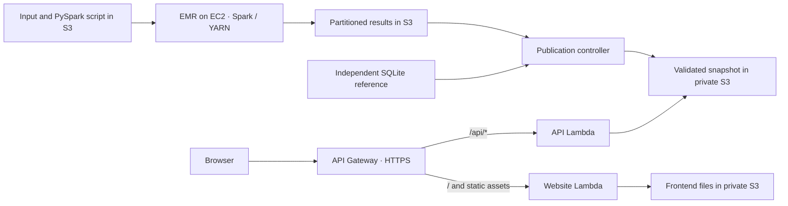

# Twitter Network Analytics

A reproducible, full-stack analytics project for **CS5224 Cloud Computing — Lab 2**. Apache Spark computes follower and followee counts from a directed Twitter graph; a Python API serves the validated results to a JavaScript frontend. The same analysis runs locally or on Amazon EMR, with independent SQLite verification before publication.

[Lab specification](docs/lab-02-specification.pdf) · [PDF report](report/A0329678H.pdf) · [Markdown report](report/A0329678H.md)


## Features

- Distributed parsing, deduplication, degree aggregation and partitioned JSON output with PySpark.
- Independent, user-by-user comparison against a SQLite reference implementation.
- Summary statistics, user lookup, prefix search, sorting, pagination and CSV export.
- HTTPS hosting through API Gateway, separate API and asset Lambda functions, and private S3 buckets.
- Infrastructure as code, recoverable EMR job submission and validation before results are published.
- Reproducible PDF and Markdown reports with source listings and actual execution evidence.

## Architecture



Spark processes the graph as a batch job. Once the completed output passes validation, the controller publishes a compressed snapshot. API requests query this snapshot rather than starting another Spark job. The API Lambda caches its in-memory index for 30 seconds; a snapshot identifier keeps paginated requests consistent with the displayed summary.

The query layer is sized for the supplied 81,306-user dataset and runs in a 512 MB Lambda function. Larger result sets would require a partitioned query store instead of loading every user into each function instance.

## Dataset and results

Each row `A B` means **A follows B**: A gains one followee and B gains one follower. The implementation:

1. Validates positive decimal identifiers of up to 20 digits and removes leading zeroes.
2. Audits blank and malformed rows separately.
3. Removes self-follow relationships and deduplicates directed edges.
4. Retains every valid endpoint, including users with zero degree after cleaning.
5. Counts followers by target and followees by source.

The input is the modified dataset supplied with the lab, derived from the [Stanford SNAP Twitter collection](https://snap.stanford.edu/data/egonets-Twitter.html). The raw lab input is a local external dependency and is excluded from Git. Its checksum below identifies the exact version used for these results.

| User ID | Followers | Followees |
|---|---:|---:|
| 214328887 | 180 | 214 |
| 107830991 | 180 | 157 |

| Metric | Result |
|---|---:|
| Input rows | 2,426,143 |
| Duplicate edges removed, after self-follow removal | 657,986 |
| Self-follow rows removed | 22 |
| Unique directed edges | 1,768,135 |
| Users | 81,306 |
| Malformed / blank rows | 0 / 0 |
| Sum of followers / sum of followees | 1,768,135 / 1,768,135 |

Input identity: **44,647,787 bytes**, SHA-256:

```text
0246d0cae6b4b3c874c968e5caed5e08753a98ce36be2ddb861fce982afdf92c
```

## Getting started

Commands below use a POSIX shell and run from the repository root.

### Preview the included results

The repository includes a validated snapshot from the recorded EMR run. Preview the application with Python's standard library:

```bash
python3 -m backend.local_server
```

Open <http://127.0.0.1:8000>. The frontend calls the local API, which serves the included results; previewing them requires no AWS account or running Spark cluster.

### Rebuild the analysis environment

Local analysis was validated with Python 3.13, Java 8 and PySpark 3.5.2. Browser verification additionally requires Node.js and Google Chrome; AWS deployment requires AWS CLI v2 and an authenticated SDK profile.

```bash
python3 -m venv .venv
.venv/bin/python -m pip install -r requirements-lock.txt
npm ci
```

The lock file recreates the verified Python environment. `requirements.txt` declares the cloud controller dependencies; `requirements-dev.txt` adds local analysis, report generation and infrastructure validation. Node.js is used for browser verification, with no frontend build step or Node.js application server.

Set `JAVA_HOME` to your Java installation when it is not already discoverable. Set `CHROME_PATH` if Chrome is installed outside the default macOS location.

### Run and verify the analysis

Place the lab dataset at `twitter_combined.txt`. Each Spark run must use a new output directory:

```bash
LAB2_RUN_OUTPUT="artifacts/spark-output/$(date -u +%Y%m%dT%H%M%SZ)"
.venv/bin/python scripts/run_spark_local.py --output "$LAB2_RUN_OUTPUT"
.venv/bin/python scripts/verify_results.py \
  --spark-output "$LAB2_RUN_OUTPUT" \
  --publish-local
```

Verification recomputes the independent reference, compares every user and audit counter, and checks the input checksum, analysis source and Spark success markers. `--publish-local` writes the validated local snapshot to `artifacts/current.json.gz`.

Start the application with the preview command above. When no valid snapshot is available, the API returns `503`.

## AWS deployment

The template provisions private S3 storage, a dedicated EMR network, IAM roles, two Lambda functions and an API Gateway HTTP API. It launches compute only when a job is submitted.

### Authenticate

Configure an IAM Identity Center profile using the account and portal assigned by your organisation:

```bash
aws configure sso --profile lab2
aws sso login --profile lab2
aws sts get-caller-identity --profile lab2 --region ap-southeast-1
```

The deployment identity needs access to CloudFormation, IAM/PassRole, S3, EMR, EC2/VPC, Lambda, API Gateway and logging. Credentials are resolved by the AWS SDK; no application `.env` file is required.

### Plan, deploy and run

Complete the local verification first so that `artifacts/reference.json.gz` matches the input. Then:

```bash
.venv/bin/python scripts/cloud.py plan
.venv/bin/cfn-lint artifacts/cloudformation.generated.json
.venv/bin/python scripts/cloud.py deploy \
  --profile lab2 --region ap-southeast-1 --execute
.venv/bin/python scripts/cloud.py run --profile lab2 --execute
```

`plan` and lint run locally. Deployment uses the generated JSON template, which embeds the current Lambda handlers; the source YAML contains code placeholders. Successful deployment records resource identifiers and the HTTPS `WebsiteUrl` in `cloud-state.json`.

The Spark job uses **EMR 7.5.0 / Spark 3.5.2**, one primary and one core **on-demand `m5.xlarge`** instance, and two YARN executors. The cluster terminates after its step completes or fails. While the controller remains running, it also enforces a 15-minute step limit and a 30-minute overall startup/execution limit.

AWS services are metered. Compute, storage and request charges depend on actual usage; credit coverage depends on the account. See [Amazon EMR pricing](https://aws.amazon.com/emr/pricing/).

Publication requires a matching `COMPLETED` step, both output success markers, consistent audit totals and a full comparison against the independent reference. The controller preserves the previous publication if validation fails.

### Resume or update a deployment

Resume an interrupted submission, wait or publication using the recorded job:

```bash
.venv/bin/python scripts/cloud.py publish --profile lab2 --execute
```

Keep `cloud-state.json` for recovery. When submission outcome is uncertain, use `publish` to find the existing cluster before starting another run.

Upload changes to frontend files, input or the Spark script with:

```bash
.venv/bin/python scripts/cloud.py upload --profile lab2 --execute
```

Changes to Lambda handlers or infrastructure require `deploy`. Changing the input also requires a new matching independent reference. CloudFormation failure details are recorded in `artifacts/evidence/cloud-deployment-failure.json`; resolve the reported resource failure before retrying a failed deployment.

## API

The API serves JSON over `GET` and disables response caching. The frontend uses same-origin requests.

| Endpoint | Purpose |
|---|---|
| `/api/health` | Result readiness and execution environment |
| `/api/summary` | Dataset audit, provenance and snapshot identifier |
| `/api/users/{id}` | Statistics for one user |
| `/api/users?ids=214328887,107830991` | Batch lookup of up to 20 IDs |
| `/api/users?limit=50&offset=0&sort=followers&search=107` | Pagination, sorting and ID-prefix search |

`limit` accepts 1–200; `offset` is non-negative. `sort` accepts `id`, `followers` or `followees`; degree sorts are descending, with ties ordered numerically by user ID. Add `snapshot_id` to bind a request to a published result. Status codes include `400` for invalid parameters, `404` for a missing user, `412` for a changed snapshot and `503` for unavailable results.

## Verification and reports

Run regression, syntax, infrastructure and actual Spark boundary checks:

```bash
.venv/bin/python scripts/check_project.py
.venv/bin/python scripts/verify_spark_edges.py
```

With the local application running, execute browser verification in another terminal:

```bash
npm run verify:browser
```

For a cloud report, verify the deployed HTTPS application instead:

```bash
APP_URL="$(.venv/bin/python -c 'import json; print(json.load(open("cloud-state.json"))["outputs"]["WebsiteUrl"])')" npm run verify:browser
```

Browser checks cover asset identity, the required user counts, pagination, sorting, search, CSV contents, mobile layout, error recovery, delayed requests and snapshot changes. Screenshot identities and hashes are stored with the checks in `browser-verification.json`. Reviewed manual screenshots are reused; otherwise, verification captures one frontend and one API image. Mobile and CSV checks leave no extra image or export files.

Generate both report formats from the shared content and execution evidence:

```bash
.venv/bin/python scripts/build_report.py
cat artifacts/report-status.json
```

Edit `report/content.json` for report text, author details and references. Generated PDF and Markdown files are named using its `student_id`; regenerating overwrites both formats. A complete cloud report requires `CLOUD_EVIDENCE_INCLUDED`, an empty `missing_evidence` list and current verification records.

Images used by the published PDF and Markdown reports are stored together in `report/assets/`:

| File | Evidence |
|---|---|
| `manual-frontend.png` | HTTPS frontend, cloud provenance, dataset metrics and required users |
| `manual-api.png` | HTTPS API response for both required users |
| `aws-emr-cluster.png` | Cluster identity, configuration and termination details |
| `aws-emr-success.png` | Matching Step ID and `Completed` state |
| `aws-s3-output.png` | Matching run directory, `_SUCCESS` and partitioned JSON files |

Manually supplied screenshots are reviewed against the job record. Their checksums, original filenames and execution identity are recorded locally in `artifacts/evidence/manual-captures.json`. Replaced images or a different cloud run require a new review record. Resource IDs and output paths are available locally in `cloud-state.json`, `cloud-job.json` and `cloud-summary.json`.

Local publication replaces the local snapshot; browser verification replaces the current browser evidence. Complete cloud publication and HTTPS verification last when preparing a cloud report. Source changes require rerunning the affected checks.

## Repository layout

| Path | Responsibility |
|---|---|
| `analysis/` | Shared Spark computation and independent SQLite reference |
| `backend/` | API handler, private-S3 asset handler and local server |
| `frontend/` | HTML, CSS and JavaScript application |
| `infra/` | CloudFormation source template |
| `scripts/` | Analysis, verification, deployment, recovery and report tooling |
| `tests/` | Regression tests and boundary fixtures |
| `docs/` | Original lab specification and reference documents |
| `report/` | Public PDF/Markdown reports, shared content source and referenced images in `assets/` |
| `artifacts/current.json.gz` | Validated result snapshot included for the local preview |
| `artifacts/` | Other generated analysis, templates and verification records remain local and are ignored by Git |
| `twitter_combined.txt` | Modified lab input; supplied locally and ignored by Git |
| `cloud-state.json` | Local deployment and recovery state; ignored by Git |

### Configuration

| Variable | Purpose |
|---|---|
| `JAVA_HOME` | Java installation used for local Spark execution |
| `CHROME_PATH` | Chrome executable used by browser verification |
| `APP_URL` | Browser verification target; defaults to `http://127.0.0.1:8000` |
| `LOCAL_SNAPSHOT` | Snapshot file served by the local API |

Lambda storage settings are supplied by CloudFormation. `.venv/`, `.tools/`, `node_modules/`, Python caches, raw input and deployment/verification state are excluded through `.gitignore`. The published reports and their original screenshots are included. Completed local Spark partitions and logs can be removed after verification; rerunning analysis creates a new output directory.

## Resource cleanup

After retaining the required results and execution evidence:

```bash
.venv/bin/python scripts/cloud.py cleanup --profile lab2 --execute
```

Cleanup terminates a recorded active cluster, waits for termination and requests deletion of the CloudFormation stack. Both S3 buckets have a `Retain` policy: they remain after stack deletion and must be emptied and deleted separately when no longer needed. Confirm stack deletion and use the resource names in `cloud-state.json` to identify retained storage. Also inspect storage retained by any earlier failed stacks.
