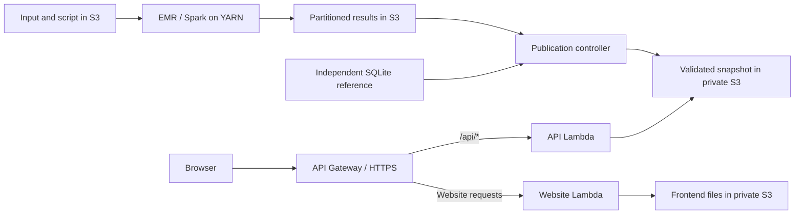

# Twitter Network Analytics

**Distributed graph processing, independently verified results, and an interactive web explorer.**

Apache Spark computes follower and followee counts from a directed Twitter graph. A Python API serves the validated results to a JavaScript frontend. The pipeline runs locally or on Amazon EMR, with independent SQLite verification before publication.

Developed for **CS5224 Cloud Computing — Lab 2**. The repository includes the implementation, final report and original screenshots of the recorded cloud run.

[Report · PDF](report/A0329678H.pdf) · [Report · Markdown](report/A0329678H.md) · [Reproducibility](docs/reproducibility.md) · [AWS deployment](docs/deployment.md) · [Lab specification](docs/lab-02-specification.pdf)


## Run the demo

```bash
git clone https://github.com/Alan42x/twitter-network-analytics.git
cd twitter-network-analytics
python3 -m backend.local_server
```

Open **http://127.0.0.1:8000**. The preview uses Python's standard library and the included, validated result snapshot. No AWS account, Spark, Java, Node.js or pip installation is needed to view it. Python 3.10+ is recommended.

The UI supports user-ID prefix search, sorting, pagination and CSV export. The cloud provenance displayed in the local preview identifies where the saved results were computed; starting the preview does not launch cloud compute.

## What can be reproduced?

| Workflow | Available from a fresh checkout | Additional requirements |
|---|---|---|
| Run the frontend and API against recorded results | Yes | Python |
| Read the final report and original run screenshots | Yes | A PDF reader or Markdown viewer |
| Run unit and infrastructure checks | Yes | The documented development dependencies |
| Recompute the exact graph statistics | Code and exact input are included | The documented Python dependencies, Java and Spark |
| Deploy and execute a new AWS run | Code, input and template are included | Generate the independent reference; supply AWS access, permissions and quota |
| Regenerate a certified cloud report | Report source is included | Matching local execution and screenshot-review records |

The exact modified dataset is included as [`twitter_combined.txt`](twitter_combined.txt), so a checkout contains the input needed to recompute the reported counts. [Reproducibility instructions](docs/reproducibility.md) explain environment setup, input verification and each workflow.

## Engineering highlights

- **Distributed computation:** DataFrame-based parsing, cleaning, deduplication, joins and degree aggregation without Python UDFs.
- **Independent validation:** every per-user result and audit counter is compared against a separate SQLite implementation.
- **Verified publication:** expected Spark arguments, a completed step, three success markers and completed work on two distinct worker hosts are checked before publication.
- **Full-stack delivery:** one Python API supports AWS Lambda and local preview; a separate Lambda serves frontend assets from private S3.
- **Consistent interaction:** snapshot-bound requests, bounded API parameters, cancellation of older searches, visible errors and retry.
- **Recoverable infrastructure:** CloudFormation, persisted submission intent, resumable publication and cluster termination after the step.

## Architecture



Spark runs as a batch job. HTTP requests query the published snapshot rather than starting Spark. The API caches its in-memory indexes for 30 seconds, and the snapshot ID keeps paginated requests consistent with the displayed summary. See [architecture and tradeoffs](docs/architecture.md).

## Dataset and results

Each row `A B` means **A follows B**: A gains one followee and B gains one follower. The implementation normalises positive decimal IDs, audits malformed/blank rows, removes self-follows and duplicate directed edges, and retains valid endpoints with zero cleaned degree.

| User ID | Followers | Followees |
|---|---:|---:|
| 214328887 | 180 | 214 |
| 107830991 | 180 | 157 |

| Metric | Recorded result |
|---|---:|
| Input rows | 2,426,143 |
| Unique directed edges | 1,768,135 |
| Users | 81,306 |
| Duplicate edges removed after self-follow removal | 657,986 |
| Self-follow rows removed | 22 |
| Malformed / blank rows | 0 / 0 |
| Sum of followers / sum of followees | 1,768,135 / 1,768,135 |

The included lab input is derived from [Stanford SNAP's Twitter social circles collection](https://snap.stanford.edu/data/egonets-Twitter.html). The exact modified input is **44,647,787 bytes**, with SHA-256:

```text
0246d0cae6b4b3c874c968e5caed5e08753a98ce36be2ddb861fce982afdf92c
```

## Development and verification

For analysis, unit tests and infrastructure validation:

```bash
python3 -m venv .venv
.venv/bin/python -m pip install -r requirements-lock.txt
.venv/bin/python scripts/check_project.py
```

`requirements.txt` declares cloud controller dependencies; `requirements-dev.txt` adds Spark, report generation and infrastructure validation; `requirements-lock.txt` pins the validated Python environment. Local analysis was exercised with Python 3.13, Java 8 and PySpark 3.5.2. Set `JAVA_HOME` when Java is not discoverable.

Optional browser QA uses Node.js 20+ and installed Chrome/Chromium. Keep the demo running in another terminal:

```bash
npm ci
npm run verify:browser
```

Set `CHROME_PATH` for a nonstandard Chrome location and `APP_URL` to verify your own deployment. Node.js is needed only for QA. The browser checks counts, ordering, pagination, search, CSV contents, mobile overflow, retry, delayed requests and snapshot changes.

See [reproducibility](docs/reproducibility.md) for fresh Spark runs, boundary checks and report regeneration, and [AWS deployment](docs/deployment.md) for provisioning, recovery and cleanup. Generated validation records remain local under `artifacts/`.

## API

| GET endpoint | Purpose |
|---|---|
| `/api/health` | Result readiness and execution environment |
| `/api/summary` | Dataset audit, provenance and snapshot ID |
| `/api/users/{id}` | Statistics for one user |
| `/api/users?ids=214328887,107830991` | Batch lookup of up to 20 IDs |
| `/api/users?limit=50&offset=0&sort=followers&search=107` | Pagination, sorting and ID-prefix search |

`limit` accepts 1–200; `offset` is nonnegative. Sort by `id`, `followers` or `followees`; degree sorts descend, with ties ordered numerically by user ID. Add `snapshot_id` to bind a request to one publication. Status codes include `400` for invalid parameters, `404` for missing users, `412` for a changed snapshot and `503` for unavailable results.

## Repository layout

| Path | Responsibility |
|---|---|
| `analysis/` | Spark job and independent SQLite reference |
| `backend/` | Shared API, private-S3 asset handler and local HTTP adapter |
| `frontend/` | Buildless HTML, CSS and JavaScript explorer |
| `infra/cloudformation.yaml` | Infrastructure source template |
| `scripts/` | Analysis, verification, AWS orchestration and report tooling |
| `tests/` | Pipeline, integrity and website regressions |
| `docs/` | Architecture, reproducibility, AWS deployment and original specification |
| `report/` | Final PDF/Markdown, shared report source and referenced image assets |
| `twitter_combined.txt` | Exact modified input included for full recomputation |
| `artifacts/current.json.gz` | Validated snapshot intentionally included for preview |

The rest of `artifacts/`, `cloud-state.json`, local credentials, installed tools, dependencies and caches are ignored. The original report and its referenced screenshots are retained for public review. [Cloud evidence instructions](docs/cloud-evidence.md) explain how to document a new execution.

## Scope and scaling

The API indexes the per-user snapshot in a 512 MB Lambda function. This suits the supplied 81,306-user dataset; larger result sets need a partitioned query store. Spark's graph processing remains distributed. The local server is a development adapter; the AWS deployment provides HTTPS through API Gateway and Lambda.
