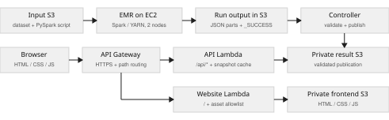
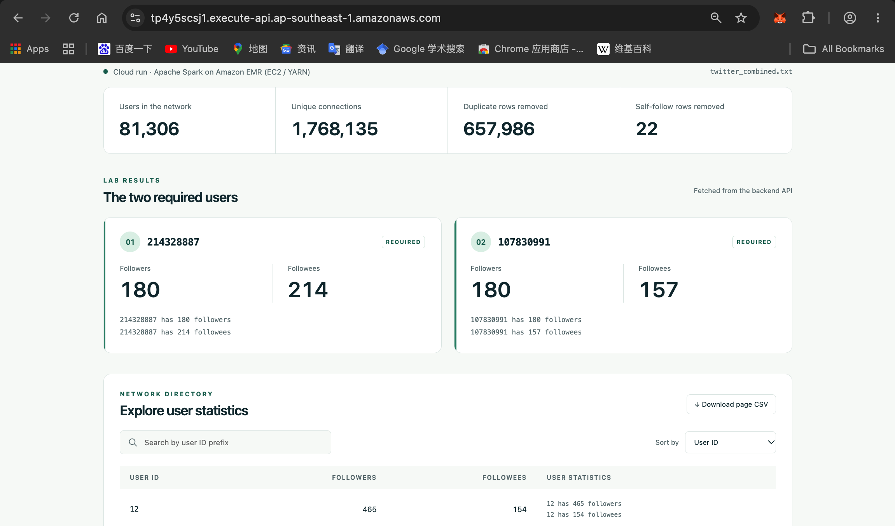
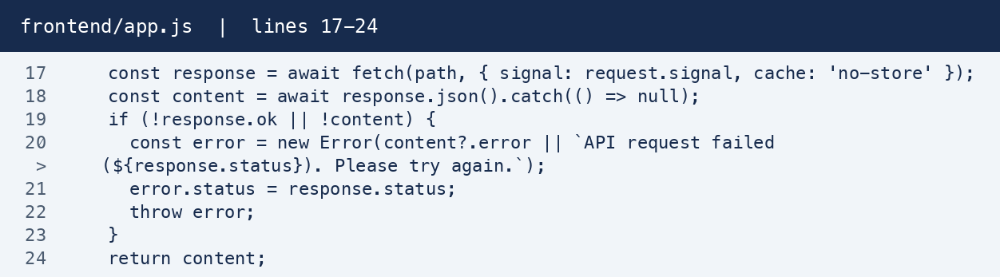
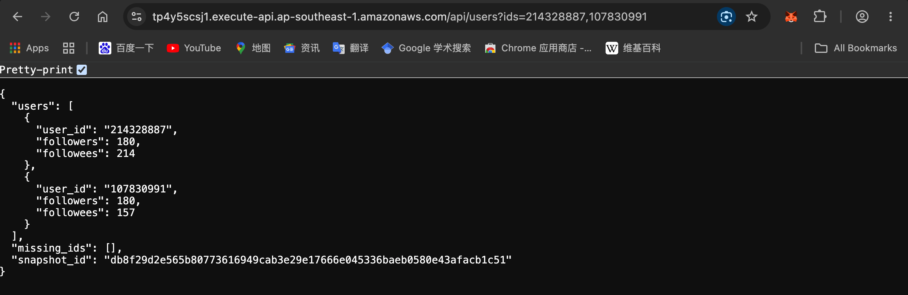
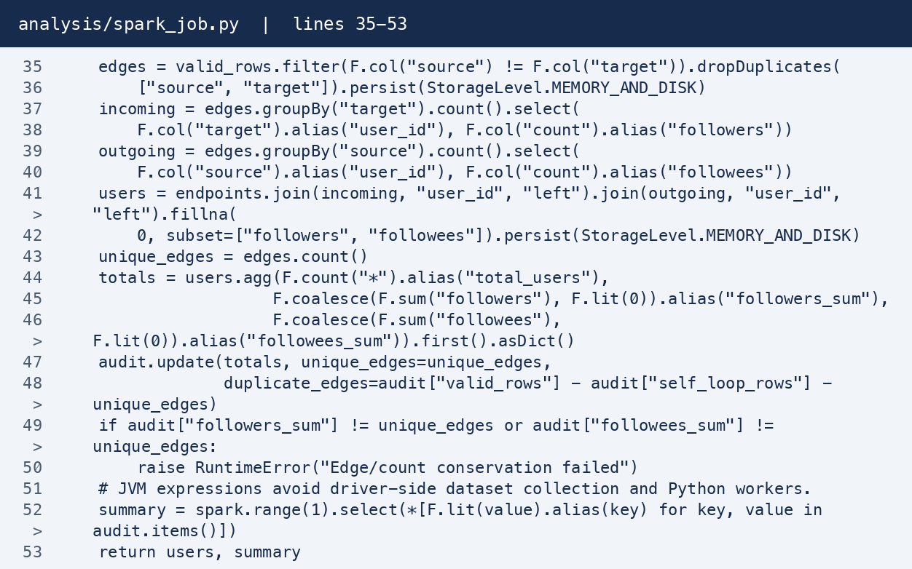
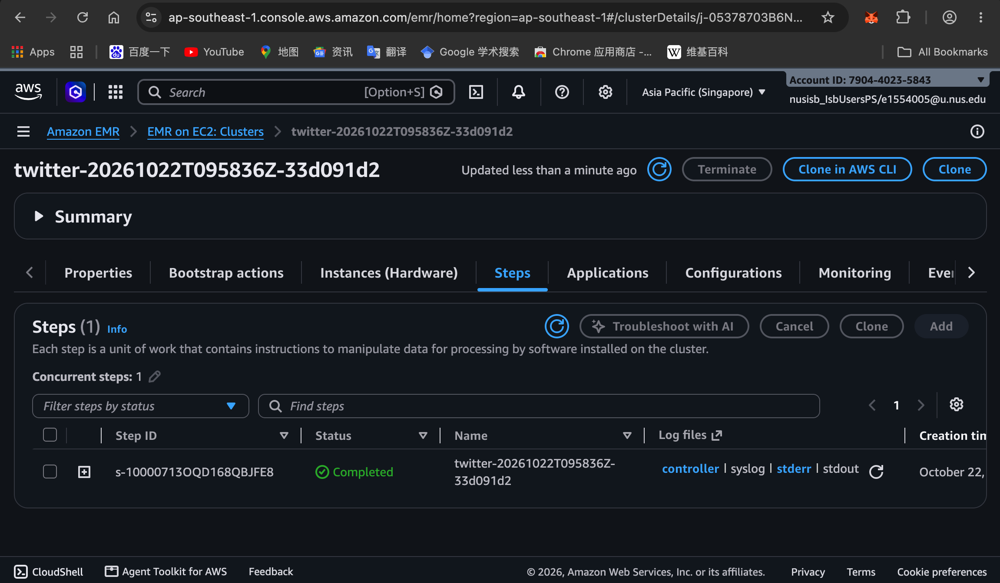
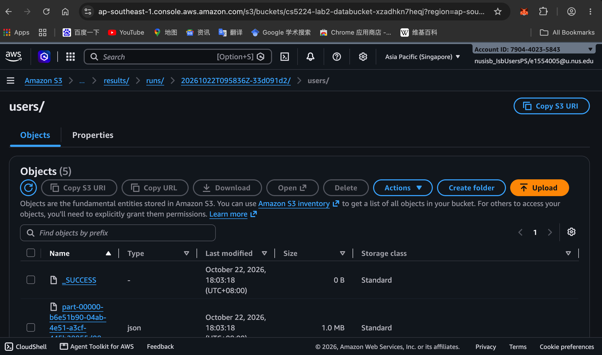
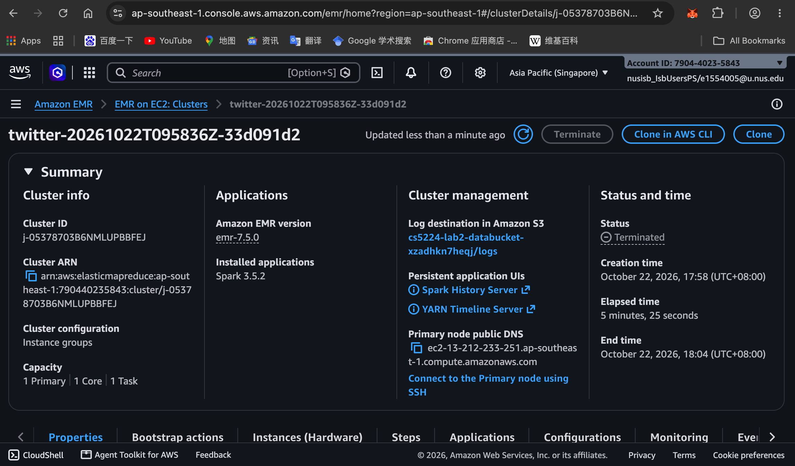

# CS5224 Lab 2 - Cloud Services & Twitter Analytics

CS5224 CLOUD COMPUTING / LAB 02

## Cloud Services & Twitter Analytics

ZHANG TIANYI  |  A0329678H  |  Laboratory report

## Part 1(a)  Healthcare analytics SaaS

**Deployment.** I would use a hybrid deployment: a community cloud restricted to participating hospitals for identifiable patient data and clinical analytics, connected to a public cloud for the SaaS frontend and approved de-identified workloads. Hospitals with stricter requirements can retain records in private clouds and exchange only authorised data. The community tier supports shared governance; the public tier supplies elastic capacity. SaaS is the service offered to hospitals, while community, private and public describe deployment models. [1]

**Governance.** The protected tier would enforce hospital-level tenancy, federated identity, least-privilege roles, encryption in transit and at rest, controlled key access, data residency, retention rules and auditable access. Every request must carry a verified tenant identity. De-identification and release checks must precede transfer to the public tier. Sensitive workloads remain protected during outbreaks; provider certifications complement application controls and hospital agreements.

**Scaling.** I would scale stateless APIs horizontally behind a load balancer using request rate and latency, buffer ingestion bursts in queues, and scale analytics workers with backlog. Partition data by hospital and region, cache suitable aggregates and apply tenant quotas. Replicate services across availability zones, test recovery, and pre-warm critical capacity before expected surges. National expansion adds regional deployments within residency rules. Private/community capacity requires advance provisioning: public-cloud bursting is limited to workloads approved for that environment.

## Part 1(b)  Bank application modernisation

**Service and deployment.** I would choose PaaS on a private cloud dedicated to the bank, with a hybrid transition while legacy services remain on premises. PaaS supplies managed runtimes, deployment automation and platform maintenance while the bank controls application logic and data. A private deployment supports exclusive access, deliberate data placement and audit requirements. PaaS is the service model; private/hybrid are deployment models. A VPC in a public cloud alone does not make that environment a private cloud under the NIST definition. [1]

**Migration and controls.** Modernise incrementally through stable APIs, staged replacement and data reconciliation. Use IaaS temporarily when legacy dependencies require operating-system control. Keep regulated records in the approved private environment and allow public services only for authorised workloads. Enforce separation of duties, controlled encryption keys, private connectivity, immutable audit records, tested recovery and retention rules. Validate provider evidence, contracts, jurisdiction and outsourcing obligations with the bank's compliance team. The tradeoff is greater cost and capacity planning than shared public PaaS, balanced by isolation and control.

PART 2 / FULL-STACK ANALYTICS PIPELINE

## System architecture

Spark computes the graph in a batch job; the web application queries a validated publication. Browser requests do not launch Spark jobs. API Gateway provides HTTPS access to separate API and website Lambda functions. [4,5]



Architecture. The controller publishes only validated results; private S3 buckets hold the dataset, output and frontend assets.

### Frontend setup

The frontend uses HTML, CSS and JavaScript stored in private S3. A Lambda asset handler serves these files through API Gateway over HTTPS. Same-origin fetch requests call /api endpoints to display the required users, searchable and paginated statistics, sorting, and CSV export.

### Backend setup

API Gateway routes /api requests to a Python Lambda function and website requests to a separate Lambda asset handler. An analysis controller uploads the dataset and PySpark script to S3, launches a three-node EMR cluster running Spark on YARN, validates the completed step and results against an independent SQLite reference, then publishes a compressed snapshot. The API Lambda reads private S3 results, caches them for 30 seconds, and serves summary and user statistics. IAM roles restrict storage access; the EMR cluster terminates after its step finishes.

### Data analysis component

Amazon EMR on EC2 runs Spark 3.5.2 on YARN using EMR release 7.5.0. [2,3] The cluster has an on-demand primary, an on-demand core worker and a Spot task worker, all m5.xlarge. Two 8 GiB executors process the S3 input across separate workers. Spark validates rows, deduplicates directed edges and aggregates followers by target and followees by source. It writes partitioned user results, audit totals and executor evidence to a new S3 run directory. Publication requires a completed step, all three success markers, tasks completed on two distinct worker hosts and agreement with the independent reference. The cluster terminates after its step.

PART 2.1 / FRONTEND

## Required user results

| User ID | Followers | Followees |
| --- | --- | --- |
| 214328887 | 180 | 214 |
| 107830991 | 180 | 157 |

214328887 has 180 followers  
214328887 has 214 followees

107830991 has 180 followers  
107830991 has 157 followees



Figure 1. Deployed HTTPS frontend. Both required users and the dataset metrics are fetched from the backend API.

### Dataset audit

| Metric | Computed value |
| --- | --- |
| Input rows | 2,426,143 |
| Duplicate / self-follow rows removed | 657,986 / 22 |
| Unique directed edges / users | 1,768,135 / 81,306 |
| Malformed / blank rows | 0 / 0 |

PART 2.2 / BACKEND

## API integration

### Frontend request handling



Figure 2. Implemented fetch logic requests uncached JSON and surfaces backend errors. Long source lines wrap for readability.

### Published API response



Figure 3. HTTPS response for the two required users. The snapshot ID identifies the published result used by the frontend.

### API contract

| GET endpoint | Behaviour |
| --- | --- |
| /api/summary | Dataset metrics, execution provenance and snapshot ID. |
| /api/users?ids=... | Batch lookup for up to 20 IDs; reports missing IDs. |
| /api/users | Pagination (1-200 rows), degree sorting and user-ID prefix search. |
| /api/users/{id} | Follower and followee counts for one user. |

Invalid parameters return 400; missing users return 404; a changed snapshot returns 412; unavailable results return 503. The frontend binds requests to one snapshot and offers retry after failure.

PART 2.3 / DATA ANALYSIS

## Spark processing & source

For each directed relationship A → B, A gains one followee and B gains one follower. Counts use distinct cleaned edges from the modified lab dataset. [6,7]

| Stage | Processing rule |
| --- | --- |
| Parse and audit | Read LF-delimited rows. Accept positive decimal IDs of up to 20 digits; normalise leading zeroes. Audit malformed and blank rows separately. |
| Clean the graph | Retain every valid endpoint. Remove self-follows and deduplicate directed (source, target) pairs. Self-loop-only users remain with zero degree. |
| Aggregate | Count targets for followers and sources for followees; left-join both counts to the complete user inventory and fill missing degrees with zero. |

### Distributed degree aggregation



Figure 4. Actual PySpark implementation, lines 35-53. Deduplication, joins and counts execute in Spark; complete selectable source appears in Appendix A.

Conservation check: both degree sums equal 1,768,135 unique edges. Only compact audit totals are collected on the driver; edge and user DataFrames remain distributed.

PART 2.3 / CLOUD EVIDENCE

## Completed job & S3 output

The submitted results were computed on Amazon EMR in ap-southeast-1. The Spark step completed on 22 Oct 2026, 18:03:23 (UTC+08:00). The screenshots below show that completed run and its output.



Figure 5. EMR Steps console: the Spark step is Completed. The run name and Step ID identify this execution.



Figure 6. S3 output for the same run. The users directory contains _SUCCESS and partitioned JSON; the console lists five objects.

PART 2.3 / CLOUD EVIDENCE

## Cluster & worker execution



Figure 7. EMR cluster summary: one primary, one core worker and one task worker. Terminated is the expected state after the completed step.

| Execution field | Recorded value |
| --- | --- |
| Spark step | s-10000713OQD168QBJFE8  /  COMPLETED |
| EMR cluster | j-05378703B6NMLUPBBFEJ |
| Runtime / region | EMR 7.5.0 / Spark 3.5.2 / ap-southeast-1 |

### Completed tasks on distinct workers

Counters were read from this application's Spark monitoring API after computation. Driver records and executors without completed tasks are excluded.

Spark application: application_1792663277899_0001

| Executor | Worker host | Tasks | Cores |
| --- | --- | --- | --- |
| 1 | ip-10-82-1-158.ap-southeast-1.compute.internal | 46 | 2 |
| 2 | ip-10-82-1-86.ap-southeast-1.compute.internal | 36 | 2 |

2 distinct worker hosts completed tasks. Each executor uses 8 GiB; the primary, core and task instances are m5.xlarge.

VALIDATION / REPRODUCIBILITY / REFERENCES

## Validation & references

### Independent verification

| Check | Recorded outcome |
| --- | --- |
| Full-dataset comparison | PASS - all 81,306 users matched independent SQLite aggregation; local Spark was an additional verification run. |
| HTTPS browser checks | PASS - 17 checks covered required counts, pagination, sorting, search, CSV, mobile layout and error recovery. |
| Python / infrastructure | PASS - 43 Python tests; syntax checks and source/generated CloudFormation cfn-lint. |
| Spark boundary cases | PASS - 7 cases covered dirty/empty input, loop-only users, CRLF, 20-digit IDs and invalid UTF-8/Unicode records. |

### Reproducibility and limits

Input and script keys are content-addressed; every Spark run uses a new output directory. The controller checks the completed step, success markers, two-worker evidence and independent result before publication. Failed or interrupted runs preserve the previous published result.

The API indexes the per-user snapshot in a 512 MB Lambda function and caches it for 30 seconds. This suits the supplied 81,306-user dataset; larger result sets require a partitioned query store. Spark's graph processing remains distributed.

Input: 44,647,787 bytes. SHA-256:

0246d0cae6b4b3c874c968e5caed5e08753a98ce36be2ddb861fce982afdf92c

Website: [https://tp4y5scsj1.execute-api.ap-southeast-1.amazonaws.com](https://tp4y5scsj1.execute-api.ap-southeast-1.amazonaws.com)

### References

1. [NIST SP 800-145: The NIST Definition of Cloud Computing](https://nvlpubs.nist.gov/nistpubs/Legacy/SP/nistspecialpublication800-145.pdf)

2. [AWS: Add a Spark step to an Amazon EMR cluster](https://docs.aws.amazon.com/emr/latest/ReleaseGuide/emr-spark-submit-step.html)

3. [AWS: Amazon EMR release 7.5.0](https://docs.aws.amazon.com/emr/latest/ReleaseGuide/emr-750-release.html)

4. [AWS: API Gateway HTTP APIs](https://docs.aws.amazon.com/apigateway/latest/developerguide/http-api.html)

5. [AWS: Lambda proxy integrations for API Gateway HTTP APIs](https://docs.aws.amazon.com/apigateway/latest/developerguide/http-api-develop-integrations-lambda.html)

6. [Stanford SNAP: Social circles, Twitter](https://snap.stanford.edu/data/egonets-Twitter.html)

7. [Apache Spark 3.5.2 documentation](https://archive.apache.org/dist/spark/docs/3.5.2/)

The SNAP reference describes the source collection. Reported results use the modified lab input identified by the checksum above.

APPENDIX A / COMPLETE PYSPARK SOURCE / 1 OF 3

## A.1  Parsing & graph cleaning

analysis/spark_job.py  |  Lines 1-36 of 119. Line numbers refer to the implemented file; continuation marks indicate visual wrapping.

```python
"""Shared entry point for local Spark and EMR on EC2; no Python UDFs."""
import argparse
import json
from urllib.parse import quote
from urllib.request import urlopen
from pyspark.sql import SparkSession, functions as F
from pyspark import StorageLevel


def compute(spark, input_path):
    # Match the oracle's LF-delimited records, including CRLF and embedded CR whitespace.
    raw = spark.read.option("lineSep", "\n").text(input_path)
    # Java's $ also matches before Unicode line terminators; use absolute anchors.
    pattern = r"\A\s*([0-9]{1,20})\s+([0-9]{1,20})\s*\z"
    parsed = raw.select(
        "value",
        F.regexp_replace(F.regexp_extract("value", pattern, 1), "^0+", "").alias("source"),
        F.regexp_replace(F.regexp_extract("value", pattern, 2), "^0+", "").alias("target"),
    ).persist(StorageLevel.MEMORY_AND_DISK)
    blank = F.col("value").rlike(r"\A\s*\z")
    valid = (F.col("source") != "") & (F.col("target") != "")

    def total(condition):
        return F.coalesce(F.sum(F.when(condition, 1).otherwise(0)), F.lit(0)).cast("long")

    audit = parsed.agg(
        F.count("*").alias("raw_lines"), total(blank).alias("blank_rows"),
        total(valid).alias("valid_rows"), total(~blank & ~valid).alias("invalid_rows"),
        total(valid & (F.col("source") == F.col("target"))).alias("self_loop_rows"),
    ).first().asDict()
    valid_rows = parsed.filter(valid).select("source", "target")
    # Keep every valid endpoint, including users whose only rows were self-loops.
    endpoints = valid_rows.select(F.col("source").alias("user_id")).union(
        valid_rows.select(F.col("target").alias("user_id"))).distinct()
    edges = valid_rows.filter(F.col("source") != F.col("target")).dropDuplicates(
        ["source", "target"]).persist(StorageLevel.MEMORY_AND_DISK)
```

APPENDIX A / COMPLETE PYSPARK SOURCE / 2 OF 3

## A.2  Aggregation & worker evidence

analysis/spark_job.py  |  Lines 37-78 of 119. Line numbers refer to the implemented file; continuation marks indicate visual wrapping.

```python
    incoming = edges.groupBy("target").count().select(
        F.col("target").alias("user_id"), F.col("count").alias("followers"))
    outgoing = edges.groupBy("source").count().select(
        F.col("source").alias("user_id"), F.col("count").alias("followees"))
    users = endpoints.join(incoming, "user_id", "left").join(outgoing, "user_id", "left").fillna(
        0, subset=["followers", "followees"]).persist(StorageLevel.MEMORY_AND_DISK)
    unique_edges = edges.count()
    totals = users.agg(F.count("*").alias("total_users"),
                      F.coalesce(F.sum("followers"), F.lit(0)).alias("followers_sum"),
                      F.coalesce(F.sum("followees"), F.lit(0)).alias("followees_sum")).first().asDict()
    audit.update(totals, unique_edges=unique_edges,
                 duplicate_edges=audit["valid_rows"] - audit["self_loop_rows"] - unique_edges)
    if audit["followers_sum"] != unique_edges or audit["followees_sum"] != unique_edges:
        raise RuntimeError("Edge/count conservation failed")
    # JVM expressions avoid driver-side dataset collection and Python workers.
    summary = spark.range(1).select(*[F.lit(value).alias(key) for key, value in audit.items()])
    return users, summary


def execution_evidence(spark, minimum_hosts):
    """Read completed-task counters from this application's live Spark monitoring API."""
    context = spark.sparkContext
    if not context.uiWebUrl:
        raise RuntimeError("Spark UI must be enabled to verify worker execution")
    application = quote(context.applicationId, safe="")
    attempt = context._jsc.sc().applicationAttemptId()
    if attempt.isDefined():
        application += "/" + quote(str(attempt.get()), safe="")
    url = f"{context.uiWebUrl}/api/v1/applications/{application}/executors"
    with urlopen(url, timeout=15) as response:
        observed = json.load(response)
    executors = [{"executor_id": row["id"], "host": row["hostPort"].rsplit(":", 1)[0],
                  "completed_tasks": row["completedTasks"], "total_cores": row["totalCores"]}
                 for row in observed if row["id"] != "driver" and row["completedTasks"] > 0]
    hosts = sorted({row["host"] for row in executors})
    if len(hosts) < minimum_hosts:
        raise RuntimeError(f"Tasks completed on {len(hosts)} worker hosts; need {minimum_hosts}")
    return {"application_id": context.applicationId, "master": context.master,
            "spark_version": spark.version, "required_worker_hosts": minimum_hosts,
            "worker_hosts": hosts, "executors": sorted(executors, key=lambda row: row["executor_id"])}


```

APPENDIX A / COMPLETE PYSPARK SOURCE / 3 OF 3

## A.3  Output evidence & job entry point

analysis/spark_job.py  |  Lines 79-119 of 119. Line numbers refer to the implemented file; continuation marks indicate visual wrapping.

```python
def write_execution_evidence(spark, record, destination):
    # JVM expressions preserve structured evidence without launching Python workers.
    executors = F.array(*[F.struct(*[F.lit(value).alias(key) for key, value in row.items()])
                          for row in record["executors"]])
    fields = [F.lit(record[key]).alias(key) for key in
              ("application_id", "master", "spark_version", "required_worker_hosts")]
    fields += [F.array(*[F.lit(host) for host in record["worker_hosts"]]).alias("worker_hosts"),
               executors.alias("executors")]
    spark.range(1).select(*fields).write.mode("errorifexists").json(destination)


def main():
    parser = argparse.ArgumentParser(description=__doc__)
    parser.add_argument("--input", required=True)
    parser.add_argument("--output", required=True, help="New run directory; existing output is rejected")
    parser.add_argument("--partitions", type=int, default=4)
    parser.add_argument("--require-worker-hosts", type=int, default=0,
                        help="Require completed tasks on this many distinct executor hosts")
    args = parser.parse_args()
    if args.partitions < 1:
        parser.error("partitions must be positive")
    if args.require_worker_hosts < 0:
        parser.error("require-worker-hosts must be nonnegative")
    spark = SparkSession.builder.appName("CS5224-Twitter-Degree-Analytics").getOrCreate()
    try:
        spark.conf.set("spark.sql.shuffle.partitions", str(args.partitions))
        users, summary = compute(spark, args.input)
        users.repartition(args.partitions).write.mode("errorifexists").json(args.output.rstrip("/") + "/users")
        summary.coalesce(1).write.mode("errorifexists").json(args.output.rstrip("/") + "/summary")
        summary.show(truncate=False)
        users.filter(F.col("user_id").isin("214328887", "107830991")).orderBy("user_id").show(truncate=False)
        if args.require_worker_hosts:
            record = execution_evidence(spark, args.require_worker_hosts)
            write_execution_evidence(spark, record, args.output.rstrip("/") + "/execution")
            print("Verified worker execution:", json.dumps(record, sort_keys=True))
    finally:
        spark.stop()


if __name__ == "__main__":
    main()
```
