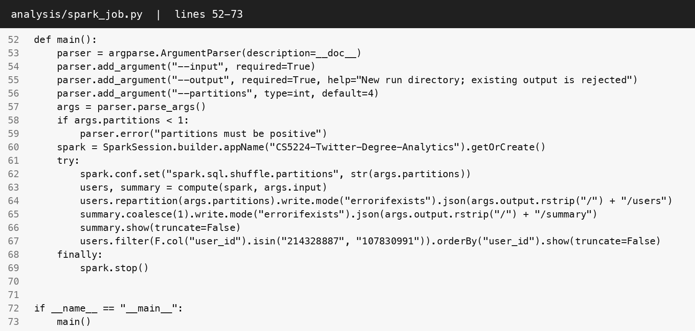

CS5224  /  LAB 02

# Cloud Services & Twitter Network Analytics

ZHANG TIANYI  |  A0329678H

## Part 1(a) - Healthcare analytics SaaS

I would use a hybrid deployment: a healthcare community cloud, restricted to participating hospitals, for identifiable patient data and clinical analytics, connected to a public cloud for the SaaS frontend and approved de-identified workloads. Hospitals with additional restrictions can retain source records in their private clouds and exchange only authorised data. A community cloud fits the hospitals' shared governance needs; the public component provides elastic capacity. These are deployment choices: SaaS describes the application offered to hospitals. [1]

The protected tier would enforce hospital-level tenancy, least-privilege roles, federated identity, encryption in transit and at rest, controlled key access, data residency, retention rules and auditable access. Each request and dataset must carry a verified tenant identity. De-identification and release checks must precede transfer to the public tier; sensitive workloads remain in the protected tier during outbreaks. Provider certifications support assurance, but application controls and hospital agreements still require validation.

For scaling, I would place stateless API instances behind a load balancer and scale them horizontally using request rate and latency. Queues would absorb ingestion bursts; distributed analytics workers would scale with backlog. Partition storage and processing by hospital and region, cache suitable aggregates, and use tenant quotas to contain noisy neighbours. Replicate services across availability zones, test backups and failover, pre-warm critical capacity and confirm quotas before expected surges. National growth adds regional cells within residency rules, rather than depending on one vertically enlarged server. Private/community capacity must be provisioned ahead of demand: public-cloud bursting cannot remove governance restrictions.

## Part 1(b) - Bank application modernisation

I would choose PaaS on a private cloud dedicated to the bank as the target, with a hybrid transition while the legacy system remains on premises. PaaS provides managed application runtimes, deployment automation and platform maintenance while the bank controls its application logic and data. The exclusive private deployment supports deliberate placement of sensitive records, access boundaries and audit requirements. PaaS is the service model; private/hybrid are deployment models. A VPC within a public cloud alone does not constitute a private cloud under the NIST definition. [1]

Modernise incrementally: expose stable APIs, replace legacy functions in stages, and reconcile data during migration. Use IaaS temporarily where legacy dependencies need operating-system control; avoid treating a lift-and-shift as the final modernisation. Keep regulated data in the approved private environment; consider public services only for explicitly authorised workloads. Enforce separation of duties, encryption with controlled keys, private connectivity, immutable audit records, tested recovery and documented retention. Assess provider evidence, contracts, jurisdiction and outsourcing obligations with the bank's compliance team. The tradeoff is greater cost and capacity planning than a shared public PaaS, balanced by isolation and control.

## Part 2 - Full-stack data analytics pipeline

### Deployment architecture

The deployed architecture uses API Gateway HTTP API routes and Lambda proxy integrations. [4,5]


### Frontend setup

The frontend uses HTML, CSS and JavaScript stored in private S3. A Lambda asset handler serves these files through API Gateway over HTTPS. Same-origin fetch requests call /api endpoints to display the required users, searchable and paginated statistics, sorting, and CSV export.

### Backend setup

API Gateway routes /api requests to a Python Lambda function and website requests to a separate Lambda asset handler. An analysis controller uploads the dataset and PySpark script to S3, launches a two-node EMR cluster running Spark on YARN, validates the completed step and results against an independent SQLite reference, then publishes a compressed snapshot. The API Lambda reads private S3 results, caches them for 30 seconds, and serves summary and user statistics. IAM roles restrict storage access; the EMR cluster terminates after its step finishes.

### Data analysis component

The configuration selects Amazon EMR on EC2 (emr-7.5.0 / Spark 3.5.2), with one primary and one core node. A Spark step runs on YARN using two executor processes. The supplied input and PySpark entry point reside in S3. [2,3] Spark validates positive decimal IDs, normalises leading zeroes, removes self-follows and deduplicates directed (source, target) pairs. Grouping by target counts followers; grouping by source counts followees. Left joins retain all valid endpoints, including zero-degree users. Distributed JSON and an audit summary are written to a new run directory. Publication requires a COMPLETED step, both output success markers and consistency validation. The cluster terminates after its step finishes.

### Semantics and data quality

Each distinct row A B is a directed edge A -> B. A gains one followee and B gains one follower. IDs remain strings. Malformed/zero IDs and blank rows are audited separately. Self-follow rows are excluded as invalid social relationships; their endpoints remain in the user inventory. Duplicates are counted after excluding self-follows. All reported values are computed from the supplied, modified dataset. [6]

## Results and frontend evidence

| User ID | Followers | Followees |
| --- | --- | --- |
| 214328887 | 180 | 214 |
| 107830991 | 180 | 157 |

214328887 has 180 followers  
214328887 has 214 followees

107830991 has 180 followers  
107830991 has 157 followees


Figure 1. Actual browser capture of the frontend. The page displays the API-supplied counts and identifies the execution environment.

### Dataset audit

| Metric | Computed value |
| --- | --- |
| Input rows | 2,426,143 |
| Duplicate / self-follow rows removed | 657,986 / 22 |
| Unique edges / users | 1,768,135 / 81,306 |
| Malformed / blank rows | 0 / 0 |

## Data analysis source code

### Core transformation: analysis/spark_job.py

Figure 2. Source listing rendered directly from the implemented file. The same function is used locally and by the configured EMR on EC2 job. All expensive aggregation and deduplication operations execute through Spark's distributed DataFrame engine. [7]


The audit summary is small and collected on the driver. The edge and user datasets remain distributed; only the publication controller reads the finished per-user results for this 81,306-user lab dataset.

## Execution and API integration

### Spark entry point and output writes



Figure 3. The entry point accepts S3 input/output URIs in the cloud, writes partitioned JSON and refuses to overwrite an existing run.

### Frontend calls the backend


Figure 4. The actual fetch function requests JSON from backend endpoints and surfaces non-success responses.

### Backend API response


Figure 5. Actual browser response from GET /api/users?ids=214328887,107830991.

## Validation and execution record

### Verification results

Spark processed all 2,426,143 input rows using local[2]. Every one of the 81,306 user records matched the independent SQLite implementation. Both degree sums equal 1,768,135 unique directed edges. Input checksum, current analysis source and output success markers were verified.

Chrome passed 17 checks against the HTTPS cloud application, including counts, ordering, pagination, search, exact CSV contents, mobile layout, startup failure, retry, delayed requests and changed-result handling. Captures are bound to the API result and current sources.

41 Python regression tests passed. The source and generated CloudFormation templates passed cfn-lint.

Actual Spark matched SQLite for 6 edge cases: dirty rows and direction, empty input, loop-only users, CRLF/carriage returns, 20-digit IDs and invalid UTF-8/Unicode whitespace.

### API contracts

GET /api/summary returns quality metrics and provenance; GET /api/users supports bounded pages, ID-prefix search and sorting; GET /api/users/{id} returns one user. Missing users return 404, invalid parameters return 400, and unavailable results return 503.

### Input SHA-256

0246d0cae6b4b3c874c968e5caed5e08753a98ce36be2ddb861fce982afdf92c

Input size: 44,647,787 bytes. Execution shown by current result: Apache Spark on Amazon EMR (EC2 / YARN).

### Cloud execution status

| Field | Recorded value |
| --- | --- |
| Step state | COMPLETED |
| Step ID | s-07830461QCAWJQ8TDQV3 |
| Cluster ID | j-10331313AHSJUSKQUS5 |
| Region | ap-southeast-1 |
| Step completed | 2026-10-21 18:56:51 (UTC+08:00) |

Website: [https://tp4y5scsj1.execute-api.ap-southeast-1.amazonaws.com](https://tp4y5scsj1.execute-api.ap-southeast-1.amazonaws.com)

## Cloud execution evidence

Original AWS console screenshots show the matching completed Spark step and its partitioned S3 output. The run name and output prefix identify the same execution recorded on the preceding page.


Figure 6. Amazon EMR Steps: the recorded Step ID is Completed.


Figure 7. The matching S3 run directory contains _SUCCESS and partitioned JSON results.

## Reproducibility and references

### Repeatable workflow

The project includes the frontend, shared Python API, independent reference implementation, complete Spark entry point, edge-case fixture, AWS template, orchestration script and report generator. Immutable input/script paths and separate run directories support reproducibility. The compressed publication is validated before replacing the previous result; unsuccessful jobs do not publish partial results.

### Runtime sizing

The API loads and indexes the compact per-user snapshot in a 512 MB Lambda function. This is appropriate for the supplied 81,306-user graph; much larger result sets should use a partitioned query store rather than loading the full inventory per instance. The Spark computation itself remains distributed.

### Sources

1. [NIST SP 800-145: The NIST Definition of Cloud Computing](https://nvlpubs.nist.gov/nistpubs/Legacy/SP/nistspecialpublication800-145.pdf)

2. [AWS: Add a Spark step to an Amazon EMR cluster](https://docs.aws.amazon.com/emr/latest/ReleaseGuide/emr-spark-submit-step.html)

3. [AWS: Amazon EMR release 7.5.0](https://docs.aws.amazon.com/emr/latest/ReleaseGuide/emr-750-release.html)

4. [AWS: API Gateway HTTP APIs](https://docs.aws.amazon.com/apigateway/latest/developerguide/http-api.html)

5. [AWS: Lambda proxy integrations for API Gateway HTTP APIs](https://docs.aws.amazon.com/apigateway/latest/developerguide/http-api-develop-integrations-lambda.html)

6. [Stanford SNAP: Social circles, Twitter](https://snap.stanford.edu/data/egonets-Twitter.html)

7. [Apache Spark 3.5.2 documentation](https://spark.apache.org/docs/3.5.2/)

Numerical results were computed from the modified dataset supplied with the lab. The SNAP reference documents the source collection; the actual input used for this analysis is identified by its SHA-256 checksum in this report.

## Supplementary cluster configuration


## Appendix - Complete PySpark source

```python
"""Shared entry point for local Spark and EMR on EC2; no Python UDFs."""
import argparse
from pyspark.sql import SparkSession, functions as F
from pyspark import StorageLevel


def compute(spark, input_path):
    # Match the oracle's LF-delimited records, including CRLF and embedded CR whitespace.
    raw = spark.read.option("lineSep", "\n").text(input_path)
    pattern = r"^\s*([0-9]{1,20})\s+([0-9]{1,20})\s*$"
    parsed = raw.select(
        "value",
        F.regexp_replace(F.regexp_extract("value", pattern, 1), "^0+", "").alias("source"),
        F.regexp_replace(F.regexp_extract("value", pattern, 2), "^0+", "").alias("target"),
    ).persist(StorageLevel.MEMORY_AND_DISK)
    blank = F.col("value").rlike(r"^\s*$")
    valid = (F.col("source") != "") & (F.col("target") != "")

    def total(condition):
        return F.coalesce(F.sum(F.when(condition, 1).otherwise(0)), F.lit(0)).cast("long")

    audit = parsed.agg(
        F.count("*").alias("raw_lines"), total(blank).alias("blank_rows"),
        total(valid).alias("valid_rows"), total(~blank & ~valid).alias("invalid_rows"),
        total(valid & (F.col("source") == F.col("target"))).alias("self_loop_rows"),
    ).first().asDict()
    valid_rows = parsed.filter(valid).select("source", "target")
    # Keep every valid endpoint, including users whose only rows were self-loops.
    endpoints = valid_rows.select(F.col("source").alias("user_id")).union(
        valid_rows.select(F.col("target").alias("user_id"))).distinct()
    edges = valid_rows.filter(F.col("source") != F.col("target")).dropDuplicates(
        ["source", "target"]).persist(StorageLevel.MEMORY_AND_DISK)
    incoming = edges.groupBy("target").count().select(
        F.col("target").alias("user_id"), F.col("count").alias("followers"))
    outgoing = edges.groupBy("source").count().select(
        F.col("source").alias("user_id"), F.col("count").alias("followees"))
    users = endpoints.join(incoming, "user_id", "left").join(outgoing, "user_id", "left").fillna(
        0, subset=["followers", "followees"]).persist(StorageLevel.MEMORY_AND_DISK)
    unique_edges = edges.count()
    totals = users.agg(F.count("*").alias("total_users"),
                      F.coalesce(F.sum("followers"), F.lit(0)).alias("followers_sum"),
                      F.coalesce(F.sum("followees"), F.lit(0)).alias("followees_sum")).first().asDict()
    audit.update(totals, unique_edges=unique_edges,
                 duplicate_edges=audit["valid_rows"] - audit["self_loop_rows"] - unique_edges)
    if audit["followers_sum"] != unique_edges or audit["followees_sum"] != unique_edges:
        raise RuntimeError("Edge/count conservation failed")
    # JVM expressions avoid driver-side dataset collection and Python workers.
    summary = spark.range(1).select(*[F.lit(value).alias(key) for key, value in audit.items()])
    return users, summary


def main():
    parser = argparse.ArgumentParser(description=__doc__)
    parser.add_argument("--input", required=True)
    parser.add_argument("--output", required=True, help="New run directory; existing output is rejected")
    parser.add_argument("--partitions", type=int, default=4)
    args = parser.parse_args()
    if args.partitions < 1:
        parser.error("partitions must be positive")
    spark = SparkSession.builder.appName("CS5224-Twitter-Degree-Analytics").getOrCreate()
    try:
        spark.conf.set("spark.sql.shuffle.partitions", str(args.partitions))
        users, summary = compute(spark, args.input)
        users.repartition(args.partitions).write.mode("errorifexists").json(args.output.rstrip("/") + "/users")
        summary.coalesce(1).write.mode("errorifexists").json(args.output.rstrip("/") + "/summary")
        summary.show(truncate=False)
        users.filter(F.col("user_id").isin("214328887", "107830991")).orderBy("user_id").show(truncate=False)
    finally:
        spark.stop()


if __name__ == "__main__":
    main()
```
